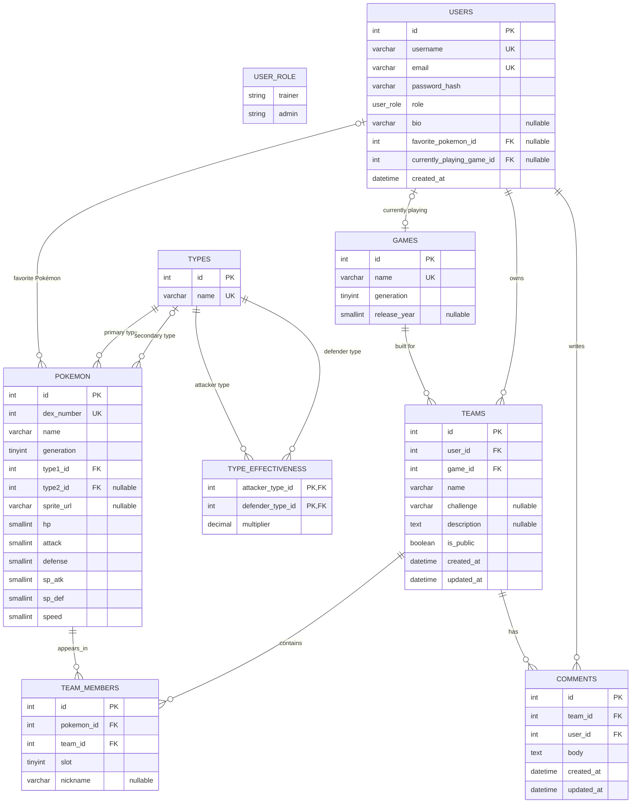

# PokéPlanner ER Diagram

## Notes

- `USER_ROLE` is shown as a conceptual enum; Mermaid ER diagrams do not model enum values as a database entity. The allowed values are `trainer` and `admin`.
- `TEAM_MEMBERS` is the join table between `TEAMS` and `POKEMON`. A Pokémon may appear more than once in a team, while each team slot is unique within that team.
- The SQL constraints described in the schema (such as valid generations, slots 1–6, distinct primary/secondary types, and allowed effectiveness multipliers) should be enforced in the actual database.
- The original final `team_members.pokemon_id <> team_members.team_id` reference is not a valid relationship between those columns; the diagram instead models the intended foreign keys to `POKEMON` and `TEAMS`.
